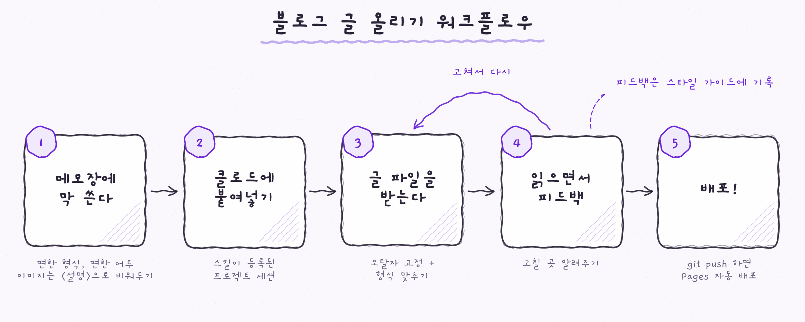

## 서론

테크 블로그든, 잡담에 대한 것이든 무언가 기록을 남겨야겠다는 생각을 항상 했다. 그런데,,솔직히 글을 쓰는 건 재밌지만, 글의 형식을 맞추고, 그에 대해 적절한 이미지를 따오고, 그걸 또 올리고,,,하는 등의 작업에 귀찮음을 느껴 그동안 미루고 있었다. 그런데 그러다가 무언가 생각이 든 게, 어? 이게 진짜 귀찮고 반복적인 일이 아닌가? 라는 생각이 들었다. 그래서 이참에 블로그도 다시 시작할 겸 해서 자동화 스킬을 만들어보았다.

## 본론

일단 큰 워크플로우부터 생각을 했다. 기존의 블로그 작성 방식은 글 작성 + 형식 맞추기(동시에 진행) -> 관련 이미지 수집 및 삽입 -> 티스토리에 글 임시 업로드 -> 피드백 -> 수정 -> 최종 배포. 이렇게 진행되었다. 여기서 자동화시킬 곳은 형식 맞추기와, 관련 이미지 수집, 업로드, 피드백, 수정, 최종 배포이다. 하나씩 어떻게 자동화시켰는지 소개하겠다.(기술적인 것 말고, 논리적으로)

1. **형식 맞추기**: 내가 이전에 쓴 글들을 클로드에게 주고, 내가 선호하는 방식의 레이아웃과 서술 방식을 학습시켰다. 하지만 내용적, 어투적 측면에서 수정이 들어가게 되면 나의 특색이 사라지는 것이니 레이아웃 부분을 자동 수정하도록 하고 오탈자 정도까지만 수정하도록 스킬을 등록하였다.
2. **이미지 수집 및 삽입**: 관련 이미지에 대한 스킬은 아직 등록하지 않았다. 왜냐면 지금 이 글이 처음으로 작성되는 글이기 때문에 이미지와 관련된 건 글을 쓰다가 생각을 하기로 결정했기 때문이다. 아마도 <이미지에 대한 설명> 이런 식으로 비워두는 부분에 맥락에 맞는 이미지를 채우도록 구현하지 않을까 싶다.
3. **피드백**: 수정된 형식에 대한 글을 파일 형식으로 받아 미리보기를 하게 했다. 본인은 코딩 이외의 목적은 모두 클로드 코드(cli)가 아닌 클로드 앱을 사용하는 것을 선호하기에, 그쪽에서 모든 작업이 이루어지도록 했다.
4. **수정**: 파일을 보면서 수정할 곳을 알려주며 수정이 진행되도록 하였다. 수정된 이력을 프로젝트의 스타일 가이드 문서에 기록하여, 내가 선호하는 형식에 대해 기록을 남겨두도록 한다.
5. **배포**: 클로드 앱에 GitHub를 연동해두면 클로드가 내 블로그 레포에 직접 git push를 할 수 있다. 먼저 push가 되면 자동으로 GitHub Pages로 최신 코드 파일이 배포되도록 GitHub Actions로 자동화해 놓는다. 그리고 클로드에게 git push를 하도록 시키면 내가 쓴 글이 올라가게 된다.

그래서 바뀐 최종 워크플로우는 이렇다.

1. 메모장에 내가 편한 형식으로, 편한 어투로 글을 쓴다. 이미지 관련된 부분은 <>형식으로 비워놓는다.
2. 글을 다 쓰면 복사/붙여넣기로 스킬이 등록되어 있는 클로드 데스크탑 프로젝트의 채팅 세션에 글을 넣는다.
3. 그러면 클로드가 수정된 글 파일을 준다.
4. 글 파일을 읽으며 수정/피드백을 한다.(이때 오간 피드백은 스타일 가이드에 기록된다.)
5. 피드백이 끝나면 최종 배포하라고 시킨다.

## 결론

에이전트 서비스를 이렇게 “각잡고 써봐야겠다!!” 라는 마음가짐으로 스킬 등록하고, 워크플로우를 짜는 것은 이번이 처음이라 미흡한 점이 많다. 아마 메모장에 쓰고 저장했을 때 자동으로 클로드가 인지하게 하도록 트리거를 짜든가, 아니면 더 다양한 자료로 내용증명을 하든가,,등등. 하지만 뭔가 나는 정보를 직접 내 손으로 수집하고, 글을 직접 내가 쓰면서 얻는 부분이 아직은 더 크다고 생각한다. 그런 의미에서 이번 에이전트는 완전 기초적인 임플란트 느낌으로 사용할 것이다.
