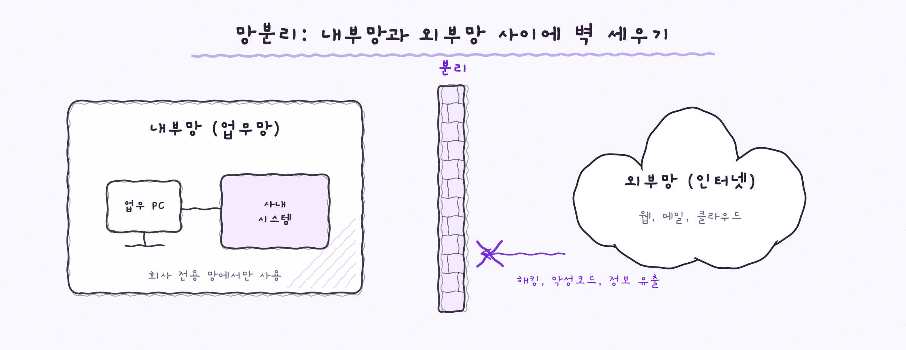
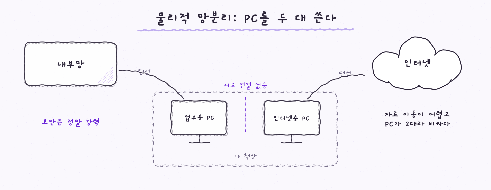
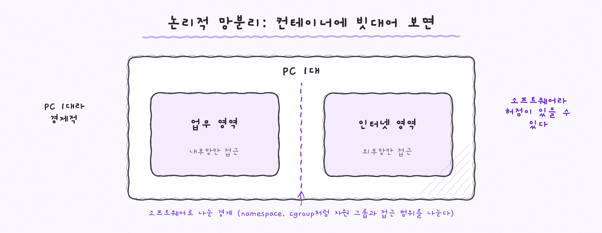
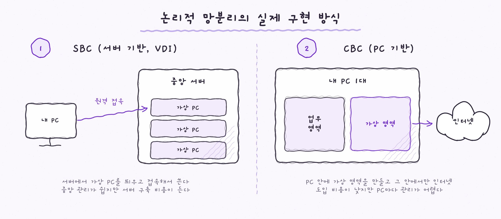

## 서론

이번에 컴퓨터 보안 수업에서 현재 최신 보안 이슈, 정책, 기술 동향에 관한 보고서를 쓰는 과제를 진행하였다. 나는 망분리를 집중해서 했고, 망분리가 완화된 빈자리를 채우는 다양한 새로운 기술들(제로 트러스트, MLS, N2SF 등)을 소개하였다. 근데 클로드와 함께 과제를 하다 보니 각각의 기술들에 대한 이해가 부족한 것 같아서...이 시리즈를 시작하게 되었다.

아마 순서는 망분리 - 제로 트러스트 - MLS, N2SF - 내가 소개? 고안? 한 새로운 보안 기술 패러다임. 이렇게 챕터가 이어질 듯하다. 이 시리즈에서는 금융 보안에 관한 이야기만 하고, 금융권 IT 인프라에 대한 지식은 따로 진행할 예정이다!(사실 이게 더 기대됨).

오늘은 망분리에 대한 개념과, 그에 관한 현재 금융권에서의 동향을 살펴보도록 하자!

## 본론

먼저 망분리가 무엇인지를 살펴보기 전에, 그것의 도입 과정을 살펴보자. 망분리는 2013년 전산망 마비 사태를 계기로 금융권에 본격적으로 도입하게 되었다. 2013년 전산망 마비 사태는 아래에 클로드가 잘 설명해 줄 것이다!


2013년 3월 20일 오후, KBS·MBC·YTN 같은 방송사와 신한은행·농협 등 금융사의 전산망이 악성코드 공격으로 한꺼번에 멈춘 사건이다. 흔히 "3·20 사이버테러"라고 부른다. PC와 서버 약 3만 2천 대가 감염됐고, 인터넷뱅킹과 ATM 이용이 중단됐다. 이후 금융당국이 내놓은 "금융전산 보안강화 종합대책"에 망분리가 담기면서 금융권의 규제로 자리 잡았다.

출처: [보안뉴스, 정보보호 20년史 2013년](https://m.boannews.com/html/detail.html?idx=82165) · [한국경제 생글생글, 3·20 해킹대란](https://sgsg.hankyung.com/article/2013032966281) · [법무법인 세종 뉴스레터](https://shinkim.com/kor/media/newsletter/pdf/2533)


암튼, 이러한 사건으로 인해 내부망과 외부망 사이의 분리가 필요해졌다. 결국에 내부망(업무 PC)에는 회사 전용 망에서만 사용 가능한 부분과, 인터넷의 연결이 가능한 외부망으로 나뉘게 되었다.

그래서?? 망분리가 정확히 무엇인가?

**회사나 기관의 내부 업무망과 외부 인터넷을 서로 분리하여(논리적 or 물리적으로) 외부 해킹, 악성코드 감염, 정보 유출 등 다양한 보안 위협에 대응하는 보안 기법!** 이다.

여기서 보면 논리적과 물리적이라는 두 가지 방식이 나온다.

### 물리적 망분리

물리적은 간단하다. 그냥 PC를 두 개 씀으로써, 하나는 내부망 랜선을 꽂고, 하나는 외부망 랜선을 꽂는 방식이다.

정말 강력한 보안성을 가지지만,,,뭔가 자료의 이동이 어렵고, 일단 컴퓨터가 2대 있어야 한다는 점에서 경제성이 떨어진다.

### 논리적 망분리

논리적이 조금 어려울 수도 있다. 이것은 약간의 CS지식이 필요하기 때문이다. 하나의 PC안에서 가상화 기술을 사용하는 방식이다. 일단 내 설명을 보고 감을 잡은 뒤 클로드의 설명을 보면 이해가 잘 될 듯하다.

여담을 먼저 하자면, 일단 나는 인프라를 하는 사람이기 때문에 컨테이너나 가상화 기술에 매우 익숙한 사람이다…그러니까 거기에 빗대어 설명하겠다. 정확한 설명은 클로드를 참고해주길 바란다.

가상화된 분리 환경의 현대 기술 중에서 가장 대표적인 컨테이너를 예로 들어 설명을 하겠다. 컨테이너는 namespace, cgroup과 같은 리눅스의 핵심 기능을 통해 자원 간의 분리를 한다. 자원 그룹을 나누고, 그에 대한 접근 제어 범위를 지정하는 방식으로 이루어진다. 논리적 망분리는 실제로는 가상화로 이루어지는데, 발상은 컨테이너와 같다. 하지만 세부 구현이나 큰 패러다임은 살짝 다르다.

여기서 중요한 건, 소프트웨어적으로 분리가 되어있다는 것이다. 컨테이너 탈출 보안 사례가 있었던 것과 같이, 소프트웨어는 분명히 허점이 존재한다. 그렇기에 논리적 망분리는 보안의 위협이 존재한다는 뜻이다. 하지만 PC를 한 대만 사용하기 때문에 경제성이 좋다는 점도 무시할 수 없다.


논리적 망분리는 주로 PC나 서버를 가상화하는 방식으로 구현한다. 크게 두 갈래다.

- **SBC (서버 기반, VDI)**: 중앙 서버에서 가상 PC를 띄우고, 사용자는 자기 PC에서 원격으로 접속해 쓴다. 중앙에서 관리하기 쉽지만 서버를 구축하는 비용이 든다.
- **CBC (PC 기반)**: 업무용 PC 안에 가상 영역을 만들고 그 안에서만 인터넷을 쓴다. 도입 비용은 낮지만 PC마다 환경이 달라 관리가 어렵다.

"소프트웨어로 경계를 나눈다"는 점은 위의 컨테이너 비유와 같다. 그래서 물리적 망분리보다 관리가 까다롭다는 평가도 같이 따라온다.

출처: [보안뉴스, 데이터 등급에 따른 망 보안 정책](https://m.boannews.com/html/detail.html?idx=131149) · [이글루코퍼레이션, 망분리 관리](https://www.igloo.co.kr/security-information/%EC%9D%B8%ED%84%B0%ED%8C%8C%ED%81%AC-%EA%B0%9C%EC%9D%B8%EC%A0%95%EB%B3%B4-%EC%9C%A0%EC%B6%9C%EC%82%AC%EA%B3%A0%EB%A1%9C-%EC%82%B4%ED%8E%B4%EB%B3%B8-%EB%A7%9D%EB%B6%84%EB%A6%AC-%EA%B4%80%EB%A6%AC/)


### 망분리 완화와 그 이후

이러한 논리적, 물리적 망분리를 통해 금융권/공공기관은 보안 위협을 방지하고 있었다. 하지만 최근 들어 클라우드의 사용, SaaS, AI 사용 등의 외부 인터넷망과의 연결이 없으면 일 효율이 너무 떨어지는 문제가 발생하였다. 그렇기에 2024년 8월에 망분리 개선 로드맵이 제시되고, 현재까지 부분적으로 적용돼오고 있다.

하지만, 망분리 개선 로드맵은 결국 망분리 규제 완화라고도 볼 수 있기 때문에 새로운 보안 허점이 생긴다고도 볼 수 있다. 이에 따라 제로 트러스트, N2SF, MLS 등 신기술이 등장하였다!(앞으로 살펴볼 애들). 이제 이러한 신기술을 살펴보면서 새로 등장한 보안 위협이 무엇인지, 어떻게 방지해야 할지 등을 알아보도록 하자.

## 결론

지금까지 망분리의 도입 배경과, 간단한 개념(논리적, 물리적 측면)을 알아보았다. 망분리는 보안 위협 대처로 인해 등장했지만, 신기술 도입으로 인해 규제가 완화되었고 그에 따른 새로운 보안 위협이 생겨났다. 망분리의 개념은 앞으로 살펴볼 새로운 기술들의 배경이 되니까 잘 알아놓도록 하자!


